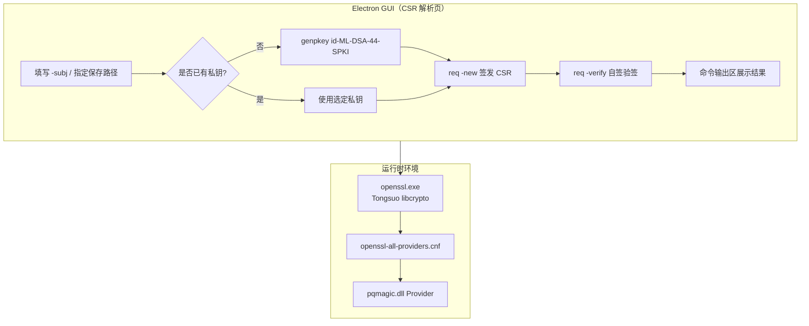
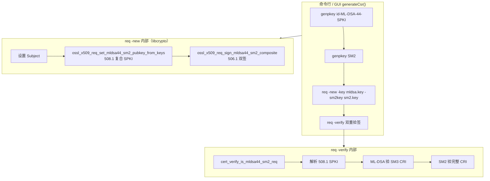

# ML-DSA-44 CSR 生成与验签：改动说明与逻辑链路

> **综合使用指南**（编译脚本、命令行、证书验链、复合 CSR `-sm2key`）：见 [usage-guide.md](./usage-guide.md)。

本文档梳理 **纯 PQC（ML-DSA-44-SPKI）** 与 **复合 ML-DSA-44-SM2** 两类证书签名请求（CSR）从密钥生成到 GUI 操作的完整链路，并在各环节说明 **改动前的问题** 与 **改动后的效果**。

| 类型 | 算法标识 | SPKI OID | 签名 OID | 密钥文件 |
|------|----------|----------|----------|----------|
| 纯 PQC | `id-ML-DSA-44-SPKI` | 1.2.156.10197.1.304.1 | 1.2.156.10197.1.505.1 | 1× ML-DSA PKCS#8 |
| 复合 | `ML-DSA-44-SM2`（req 用 `-key` + `-sm2key`） | 1.2.156.10197.1.508.1 | 1.2.156.10197.1.506.1 | ML-DSA + SM2 各一 PKCS#8 |

样例 CSR：`certs/1`（纯 PQC）、`certs/2/csr/用户证书请求.csr`（复合）。

---

## 1. 目标与背景

### 1.1 目标

在不依赖 `certs/1`、`certs/2` 等预置材料的前提下，通过 **OpenSSL 3 Provider + Tongsuo libcrypto 补丁** 完成：

**纯 PQC（ML-DSA-44-SPKI）**

1. `openssl genpkey -algorithm id-ML-DSA-44-SPKI` — 生成 ML-DSA-44 密钥对  
2. `openssl req -new -key … -subj … -out …` — 签发 PKCS#10 CSR  
3. `openssl req -in … -verify -noout` — 验证 CSR 自签名  

**复合 ML-DSA-44-SM2（双钥 + `-sm2key`）**

1. `openssl genpkey -algorithm id-ML-DSA-44-SPKI` + `openssl genpkey -algorithm SM2` — 各生成一把标准私钥  
2. `openssl req -new -key <mldsa.key> -sm2key <sm2.key> -subj … -out …` — 签发复合 PKCS#10  
3. `openssl req -in … -verify -noout` — 经 `cert_verify` 双重验签（ML-DSA + SM2）  

并在 Electron GUI「CSR 解析」页对两种算法提供一键生成、查看与验签。

### 1.2 复合 CSR 方案选择

| 方案 | 说明 | 结论 |
|------|------|------|
| 单一 `composite.key`（pqmagic 复合 PKCS#8） | 需在 provider 实现复合 GEN / 编解码 | **未采用** — 两把标准钥无法各自复用 |
| **双钥 + `req -sm2key`** | ML-DSA 走 pqmagic GEN；SM2 走 default provider；libcrypto 在 `req -new` 时拼接 SPKI 与双签 | **已采用** — 与 `certs/2` 规格一致，CLI/GUI 工作流清晰 |

复合 CSR **不**扩展 pqmagic 做 `id-ML-DSA-44-SM2` 密钥类型；拼接与双签逻辑在 Tongsuo `x509_pqc_hybrid_sign.c`，验签在 `cert_verify.dll`。

### 1.3 整体方案对比（纯 PQC）

| 维度 | 改动前 | 改动后 |
|------|--------|--------|
| 密钥来源 | 只能用 `certs/1` 等目录里已有的 PKCS#8 + 证书；**无法** `genpkey` 现场生成 | Provider 实现 keymgmt GEN，`genpkey` 一步出密钥 |
| CSR 构造 | `gen-csr-pqc.ps1` 注释写明「openssl req -new 目前不支持 ML-DSA-44-SPKI」；靠 Python 拼 ASN.1 + 外部 `mldsa_sign_sm3.exe` | 标准 `openssl req -new`，与 SM2/RSA 工作流一致 |
| Provider 能力 | 仅能 **解析/验签** 证书里已有的国密 SPKI；无 GEN、无 PKCS#8 写盘、无 CSR 签名 | 补齐 GEN / Encoder / Decoder / Signature 全链路 |
| GUI | 仅有 CSR **查看与验签**；不能生成 | 新增「生成 CSR」：subj、保存路径、可选私钥、一键三连（genpkey → req → verify） |
| 用户感知 | 必须准备脚本、Python、签名工具、固定目录材料 | 与常规 OpenSSL 用法相同，GUI 点按钮即可 |

旧脚本（`bin/gen-csr-pqc.ps1` / `gen-csr-certs1.py` / `gen-csr-certs2.py`）仍保留，用于 `certs/1`、`certs/2` 等历史材料；新 GUI「生成 CSR」与 CLI demo 走 Provider + `-sm2key` 主路径。

### 1.4 整体方案对比（复合 ML-DSA-44-SM2）

| 维度 | 改动前 | 改动后 |
|------|--------|--------|
| 密钥 | 依赖 `certs/2` 预置 ML-DSA / SM2 材料 | 两把 `genpkey` 现场生成，**不**合成单一密钥文件 |
| CSR 构造 | `gen-csr-certs2.py` 拼 ASN.1 + 外部 `mldsa_sign_sm3.exe` | 标准 `openssl req -new -key … -sm2key …` |
| libcrypto | 无 `-sm2key`；无法写 508.1 SPKI / 506.1 双签 | `x509_pqc_hybrid_sign.c` + `req.c` 补丁 |
| 验签 | Python `verify-csr-certs2.py` 对照脚本 | `openssl req -verify` → `cert_verify_req_mldsa44_sm2_composite` |
| GUI | 未接入 | 选「ML-DSA-44-SM2」→ 自动双 genpkey + `-sm2key` + verify |

---

## 2. 纯 PQC（ML-DSA-44-SPKI）端到端链路

### 2.1 总览



**改动前**：GUI 只能执行「选择已有 CSR → 查看 / 验签」，中间三步（genpkey、req -new、verify）均无法在界面完成，且 CLI 上 genpkey / req -new 本身也不通。

**改动后**：GUI `generateCsr()` 串联上述三步；底层依赖 provider 与 libcrypto 补丁，使 CLI 与 GUI 行为一致。

### 2.2 命令行等价流程

演示目录：`tlcp-pqc/certs/_provider_gen/`

```bash
set OPENSSL_CONF=D:\...\tlcp-pqc\config\openssl-all-providers.cnf
set OPENSSL_MODULES=D:\...\tlcp-pqc\providers

openssl genpkey -algorithm id-ML-DSA-44-SPKI -out mldsa.key
openssl req -new -key mldsa.key -subj "/C=CN/ST=Beijing/O=Demo/CN=provider-gen.demo" -out demo.csr
openssl req -in demo.csr -verify -noout
# 期望输出：verify OK
```

一键脚本：`tlcp-pqc/bin/demo-provider-gen-csr.bat`。

| 命令 | 改动前 | 改动后 |
|------|--------|--------|
| `genpkey -algorithm id-ML-DSA-44-SPKI` | `gen_init: operation not supported for this keytype`（provider 无 GEN） | 正常写出 `mldsa.key` |
| `req -new -key mldsa.key …` | 私钥加载或 SPKI 编码或签名任一步失败，无法出 CSR | 正常写出 `demo.csr` |
| `req -verify` | 对 Python 手工拼的 CSR 可用；对 `req -new` 产物此前无法生成故未测通 | `verify OK` |

### 2.3 `genpkey` 内部链路

```
openssl genpkey
  └─ EVP_PKEY_keygen (OpenSSL 3)
       └─ pqmagic provider: keymgmt GEN
            ├─ mldsa_gen_init
            ├─ mldsa_gen        → pqmagic_ml_dsa_44_std_keypair(pk, sk)
            └─ mldsa_gen_cleanup
       └─ OSSL_ENCODER (DER/PEM PKCS#8)
            └─ pqmagic_sk_to_pkcs8_der（sk + 属性 OID 附带 pk）
       └─ 输出 PEM/DER 私钥文件
```

#### 2.3.1 密钥生成（keymgmt GEN）

| | 改动前 | 改动后 |
|---|--------|--------|
| **问题** | 未注册 `OSSL_FUNC_KEYMGMT_GEN_*`；OpenSSL 找不到该算法的 keygen 实现 | — |
| **现象** | `openssl genpkey -algorithm id-ML-DSA-44-SPKI` 立即失败 | `genpkey` 成功，内存中已有 pk/sk |
| **改法** | — | 实现 `mldsa_gen_init` / `mldsa_gen` / `mldsa_gen_cleanup`，`mldsa_gen` **直接返回** `struct pqmagic_raw_key *` |
| **细节** | 若误用 `OSSL_CALLBACK` 上报 `OSSL_OBJECT`，OpenSSL 3 仍报 `operation not supported` | 返回裸 key 指针，符合 keymgmt GEN 约定 |

#### 2.3.2 私钥写盘（PKCS#8 Encoder）

| | 改动前 | 改动后 |
|---|--------|--------|
| **问题** | 无 PKCS#8 DER/PEM encoder；或仅有 DER 无 PEM | — |
| **现象** | 密钥在内存生成后无法写入 `-out` 文件；或报 `Error writing key` | `mldsa.key` 为合法 PEM PKCS#8 |
| **改法** | — | `pqmagic_sk_to_pkcs8_der` + PEM encoder；用自定义属性 OID `1.2.156.10197.1.304.1.1` 附带 1312B 公钥 |
| **为何附带公钥** | 标准 PKCS#8 只存 sk；后续 `req -new` 需从 pkey 导出 SPKI，缺 pk 则编码失败 | 解码时从属性恢复 pk，一条私钥文件即可走完 CSR 流程 |

### 2.4 `req -new` 内部链路

```
openssl req -new -key mldsa.key
  └─ 加载私钥 → PKCS#8 decoder（属性恢复 pk；旧材料 PUBLIC KEY / .crt 补全）
  └─ X509_REQ：Subject + X509_PUBKEY_set（encoder → SPKI；失败则手动解析）
  └─ EVP_DigestSign (ML-DSA-44-with-SM3) → 写 CSR 签名
  └─ 输出 PKCS#10
```

#### 2.4.1 私钥加载与公钥补全

| | 改动前 | 改动后 |
|---|--------|--------|
| **新 key（provider 生成）** | PKCS#8 解码后只有 sk，pkey 无 `ENCODED_PUBLIC_KEY`，SPKI 编码失败 | 属性 OID 解码恢复 pk；pkey 完整 |
| **旧 key（如 `certs/1/user_sig.key`）** | PEM 内常有独立 `PUBLIC KEY` 块，但 loader 未合并；或仅 sk 且无 `.crt` 则失败 | `hybrid_read_pq_key_material` 读同文件 `PUBLIC KEY`；仍缺则 `hybrid_supplement_mldsa_pubkey` 从同名 `.crt` 补全 |
| **路径误匹配** | `user_sig_pkcs8.key` 猜证书变成 `user_sig_pkcs8.crt`（不存在） | `hybrid_guess_cert_path` 去掉 `_pkcs8` 后缀再拼 `.crt` |

#### 2.4.2 CSR 公钥字段（X509_PUBKEY_set）

| | 改动前 | 改动后 |
|---|--------|--------|
| **问题** | Provider 密钥无 legacy `ameth->pub_encode`；且编出的 SPKI 含国密 OID `1.2.156.10197.1.304.1`，`d2i_X509_PUBKEY` 不认识 | — |
| **现象** | `req -new` 在写 `req_info.pubkey` 时失败 | CSR 内 SPKI 正确写入 |
| **改法（provider）** | 无 SPKI encoder | DER `SubjectPublicKeyInfo` encoder（`pqmagic_pubkey_to_spki_der`） |
| **改法（libcrypto）** | `X509_PUBKEY_set` 对 provided key 直接失败 | 走 `OSSL_ENCODER` 取 DER；`d2i` 失败则 `x509_pubkey_from_spki_der` 手动拆 SEQUENCE |

#### 2.4.3 CSR 签名（ML-DSA-44-with-SM3）

| | 改动前 | 改动后 |
|---|--------|--------|
| **AlgorithmIdentifier** | 未实现 `OSSL_SIGNATURE_PARAM_ALGORITHM_ID`；`ASN1_item_sign_ctx` 写不出正确签名算法 OID | `pqmagic_sig_build_aid` + get_ctx_params 返回 AID DER |
| **摘要算法** | `digest_sign_init` 见 req 默认 `sha256` 即拒绝；或 keymgmt 未声明默认摘要 | 忽略外部 mdname，内部固定 SM3；keymgmt 导出 `DEFAULT_DIGEST` = `"SM3"` |
| **签名长度查询** | `EVP_DigestSign(NULL,…)` 走 `digest_sign_final`，此时 `acc` 为空 → 失败 | `digest_sign_final` 在 `sig==NULL` 时直接返回 2420；并实现 `digest_sign` 一次性路径 |
| **现象** | `req -new` 在签名阶段 abort | CSR 带 2420 字节 ML-DSA 签名，算法标识 ML-DSA-44-with-SM3 |

### 2.5 `req -verify` 内部链路

```
openssl req -in demo.csr -verify -noout
  └─ 解析 CSR → SPKI + 签名算法
  └─ provider digest_verify：SM3(TBS) + ML-DSA 验签
  └─ verify OK
```

| | 改动前 | 改动后 |
|---|--------|--------|
| **对 Python 生成的 CSR** | 验签路径已有，一般可用 | 不变 |
| **对 `req -new` 生成的 CSR** | 此前无法生成，verify 无从谈起 | 自签验签通过，与生成路径算法一致 |

### 2.6 GUI 调用逻辑

文件：`certificate-verification-win32-x64/resources/app/index.html` — `generateCsr()`。

| 步骤 | 行为 |
|------|------|
| 校验 | 运行时、`subj` 以 `/` 开头、已指定 CSR 保存路径 |
| 私钥 | 未选 → CSR 同目录同名 `.key`；已选 → 复用 |
| 生成 | `genpkey -algorithm id-ML-DSA-44-SPKI -out <key>` |
| 签发 | `req -new -key <key> -subj <subj> -out <csr>` |
| 验签 | `req -in <csr> -verify -noout` |
| 回填 | 成功后将 CSR 路径填入「查看与验签」 |

| | 改动前 | 改动后 |
|---|--------|--------|
| **界面** | 仅「选择 CSR → 查看 / 验签」 | 增加「生成 CSR」区块：subj 默认值、可选私钥、指定保存路径 |
| **运行时** | 内置旧版 `pqmagic.dll`（约 66KB，无 GEN） | 同步新构建（约 76KB）+ 补丁版 `libcrypto` |
| **现象** | 点「生成 CSR」报 `gen_init: operation not supported`（CLI 已修、GUI 未同步时） | 与命令行 demo 等价，三步输出写入命令输出区 |
| **环境** | 无 `OPENSSL_MODULES` 或配置路径不对时 provider 未加载 | `buildOpensslEnv()` 注入 `PATH` / `OPENSSL_CONF` / `OPENSSL_MODULES`；启动时按 app 路径生成 cnf |

---

## 2B. 复合 ML-DSA-44-SM2 CSR 链路

本节对应 `certs/2` 规格：公钥 OID **508.1**（1312B ML-DSA ‖ 65B SM2 裸公钥），签名 OID **506.1**（2420B ML-DSA ‖ SM2 DER 签名）。

### 2B.1 总览



**设计要点**：两把私钥均为标准 PKCS#8；ML-DSA 钥可单独用于纯 PQC CSR，SM2 钥可单独用于国密 CSR。

### 2B.2 命令行等价流程

演示目录：`tlcp-pqc/certs/_provider_gen_composite/`

```bash
set OPENSSL_CONF=D:\...\tlcp-pqc\config\openssl-all-providers.cnf
set OPENSSL_MODULES=D:\...\tlcp-pqc\providers

openssl genpkey -algorithm id-ML-DSA-44-SPKI -out demo.mldsa.key
openssl genpkey -algorithm SM2              -out demo.sm2.key
openssl req -new -key demo.mldsa.key -sm2key demo.sm2.key \
  -subj "/C=CN/ST=Beijing/O=TLCP-PQC/OU=Demo/CN=ProviderGenComposite" \
  -out demo.csr
openssl req -in demo.csr -verify -noout
```

一键脚本：`tlcp-pqc/bin/demo-provider-gen-composite-csr.bat`（**不重编**，适合日常演示）。

| 命令 | 改动前 | 改动后 |
|------|--------|--------|
| 双 `genpkey` | ML-DSA 需 provider GEN；SM2 走 default | 均 OK |
| `req -new … -sm2key …` | 无 `-sm2key` 选项；或无法写 508.1/506.1 | 正常输出复合 CSR |
| `req -verify` | 仅 Python 脚本可验 | cert_verify 双重验签 + `verify OK` |

### 2B.3 `req -new -sm2key` 内部链路

```
openssl req -new -key mldsa.key -sm2key sm2.key
  └─ req.c：load_key(mldsa) + load_key(sm2)；校验 pkey 类型
  └─ make_REQ()：X509_REQ_set_subject_name
  └─ ossl_x509_req_set_mldsa44_sm2_pubkey_from_keys()
       ├─ 从 ML-DSA pkey 取 1312B pk（OSSL_PKEY_PARAM_ENCODED_PUBLIC_KEY）
       ├─ 从 SM2 pkey 经 OSSL_ENCODER(SPKI DER) 取末 65B 裸公钥
       └─ X509_PUBKEY_set0_param(NID_ML_DSA_44_SM2, combo[1377])
  └─ ossl_x509_req_sign_mldsa44_sm2_composite()
       ├─ i2d_re_X509_REQ_tbs → CRI
       ├─ EVP_DigestSign(SM3, mldsa_pkey) → 2420B
       ├─ EVP_DigestSign(SM3, sm2_pkey, id=1234567812345678) → SM2 DER sig
       └─ 拼接写入 signatureAlgorithm 506.1 + BIT STRING
```

#### 2B.3.1 `req.c` 新增 `-sm2key`

| 项 | 说明 |
|----|------|
| 选项 | `-sm2key <file>` — SM2 私钥路径，须与 `-key`（ML-DSA-44-SPKI）联用 |
| 约束 | 不可与 `-x509` 同用；`-key` 必须是 `id-ML-DSA-44-SPKI` |
| 加载 | `load_key(sm2keyfile)` → 校验 `EVP_PKEY_is_a(..., "SM2")` |
| 公钥 | `make_REQ()` 内调用 `ossl_x509_req_set_mldsa44_sm2_pubkey_from_keys`，**替代** `X509_REQ_set_pubkey` |
| 签名 | 扩展处理完成后调用 `ossl_x509_req_sign_mldsa44_sm2_composite`，**替代** `do_X509_REQ_sign` |

#### 2B.3.2 `x509_pqc_hybrid_sign.c`

| 函数 | 作用 |
|------|------|
| `ossl_x509_req_set_mldsa44_sm2_pubkey_from_keys` | 提取双钥裸公钥，写入 OID 508.1 复合 SPKI |
| `ossl_x509_req_sign_mldsa44_sm2_composite` | CRI 双签，算法 OID 506.1 |

**实现细节（曾踩坑）**：

- `X509_PUBKEY_set0_param` / `X509_ALGOR_set0` 的 algorithm 参数须 `OBJ_dup(OBJ_nid2obj(NID_…))`，不可直接传 `OBJ_nid2obj` 指针。
- SM2 公钥提取使用 `OSSL_ENCODER` 输出 SPKI DER 再取末 65 字节，避免 deprecated `EC_KEY` API 崩溃。
- 签名算法用 `X509_ALGOR_new()` + `X509_ALGOR_set0`，不用不存在的 `X509_ALGOR_init/reset`。

### 2B.4 `req -verify` 双重验签链路

```
openssl req -in demo.csr -verify -noout
  └─ libcrypto 识别 signature nid = NID_ML_DSA_44_SM2_with_SM3 (506.1)
  └─ cert_verify provider：cert_verify_req_mldsa44_sm2_composite()
       ├─ parse_mldsa44_sm2_spki_raw_pubkey（508.1 → ML-DSA pk + SM2 pk）
       ├─ i2d_re_X509_REQ_tbs → CRI
       ├─ [1/2] ML-DSA-44-with-SM3：验签 CRI 前 2420 字节段（pqmagic）
       └─ [2/2] SM2-with-SM3：验签 CRI 余下 SM2 DER 段
  └─ Certificate request self-signature verify OK
```

| | 改动前 | 改动后 |
|---|--------|--------|
| **权威验签** | `verify-csr-certs2.py` + `mldsa_sign_sm3.exe` | `openssl req -verify`（hooks 进 cert_verify） |
| **Python 脚本** | 唯一可用路径 | 保留作对照；**长 subject** 的 CRI 提取可能与 libcrypto 略有差异，以 OpenSSL 为准 |
| **Provider 依赖** | 无 | 须加载 `cert_verify` + `pqmagic` + `ml_dsa_sm2` |

### 2B.5 GUI 复合 CSR 逻辑

文件：`certificate-verification-win32-x64/resources/app/index.html` — `generateCsr()`，`algo.id === 'id-ML-DSA-44-SM2'` 分支。

| 步骤 | 行为 |
|------|------|
| 密钥路径 | 由 CSR 保存路径推导：`<stem>.mldsa.key`、`<stem>.sm2.key`（`deriveCompositeKeyPathsFromCsr`） |
| 生成 | `genpkey id-ML-DSA-44-SPKI` → `genpkey SM2` |
| 签发 | `req -new -key <mldsa> -sm2key <sm2> -subj … -out <csr>` |
| 验签 | `req -in <csr> -verify -noout` |
| UI | **无需**第二个密钥上传框；算法下拉选「ML-DSA-44-SM2」即可 |

| | 改动前 | 改动后 |
|---|--------|--------|
| **算法下拉** | ML-DSA-44-SM2 标记未实现 | `implemented: true` |
| **操作** | 只能查看/验签已有 `certs/2` CSR | 与 `demo-provider-gen-composite-csr.bat` 等价四步 |

---

## 3. 关键数据与 OID

### 3.1 纯 PQC（ML-DSA-44-SPKI）

| 项目 | 值 |
|------|-----|
| 算法名 | `id-ML-DSA-44-SPKI` / `ML-DSA-44-SPKI` |
| 签名算法 | `ML-DSA-44-with-SM3`（摘要固定 SM3） |
| SPKI OID | `1.2.156.10197.1.304.1` |
| PKCS#8 公钥属性 OID | `1.2.156.10197.1.304.1.1`（1312 字节裸公钥） |
| 裸公钥 / 私钥 / 签名 | 1312 / 2560 / 2420 字节 |

### 3.2 复合 ML-DSA-44-SM2

| 项目 | 值 |
|------|-----|
| req 用法 | `-key <ML-DSA PKCS#8>` + `-sm2key <SM2 PKCS#8>` |
| SPKI OID | `1.2.156.10197.1.508.1`（NID_ML_DSA_44_SM2） |
| 复合裸公钥 | ML-DSA 1312B ‖ SM2 65B = **1377 字节** |
| 签名算法 OID | `1.2.156.10197.1.506.1`（ML-DSA-44-SM2-with-SM3） |
| 复合签名 | ML-DSA 2420B ‖ SM2 DER sig（通常 ~70B） |
| SM2 默认 ID | `1234567812345678`（与 certs/2 一致） |
| CRI / TBS | ML-DSA 与 SM2 **均签完整 CRI**（非截断 TBS） |

### 3.3 OID 贯通性

**改动前**：304.1 / 508.1 等 OID 仅在 **decoder**（读证书/读 SPKI）侧有定义；复合 CSR **无法**通过标准 `req -new` 写出。

**改动后**：

- **纯 PQC**：304.1 / 505.1 在 GEN → PKCS#8 → SPKI → CSR 签名 → verify 全路径一致（pqmagic + x_pubkey 补丁）。
- **复合**：508.1 / 506.1 在 `-sm2key` 写 CSR → `cert_verify` 验 CSR / 验证书（certs/2）路径一致；**不**经 pqmagic 复合 GEN。

---

## 4. 改动清单（按模块）

### 4.1 pqmagic Provider（`pqmagic-algorithms-provider/pqmagic_prov.c`）

#### Key Management — 密钥生成

| 函数 | 作用 |
|------|------|
| `mldsa_gen_init` | 初始化 GEN 上下文 |
| `mldsa_gen` | `pqmagic_ml_dsa_44_std_keypair` → 返回 `pqmagic_raw_key` |
| `mldsa_gen_cleanup` | 释放上下文 |

**改动前**：keymgmt 仅有 import/export/query，**无 GEN** → `genpkey` 不可用。  
**改动后**：注册 `GEN_INIT / GEN / GEN_CLEANUP`，`genpkey` 成为 CSR 链路的起点。

#### Key Management — 参数导出

- `OSSL_PKEY_PARAM_DEFAULT_DIGEST` → `"SM3"`
- `OSSL_PKEY_PARAM_ENCODED_PUBLIC_KEY` → 1312 字节 pk

**改动前**：未导出默认摘要，`req` 与 signature 层对 digest 协商失败或误用 sha256。  
**改动后**：OpenSSL 与 provider 对齐到 SM3，符合国密 ML-DSA 签名套件。

#### Encoder

| 编码目标 | 改动前 | 改动后 |
|----------|--------|--------|
| DER SubjectPublicKeyInfo | 无 | `pqmagic_pubkey_to_spki_der`，供 `X509_PUBKEY_set` |
| DER/PEM PKCS#8 | 无或不全 | `pqmagic_sk_to_pkcs8_der` + 公钥属性 OID |
| TEXT | 无或不可读 | 供 `pkey -text` / 调试 |

**改动前**：`genpkey` 即使内存有 key 也无法 `-out`；`req -new` 无法把公钥写入 CSR。  
**改动后**：私钥文件可持久化；CSR 公钥字段可编码。

#### Decoder

- SPKI DER：解析国密 OID 裸公钥（原有，用于验链）
- PKCS#8：`pqmagic_pkcs8_get_embedded_pubkey` 从属性恢复 pk

**改动前**：PKCS#8 解码只有 sk → 后续 SPKI 编码缺 pk。  
**改动后**：与 encoder 对称，round-trip 不丢公钥。

#### Signature — ML-DSA-44-with-SM3（纯 PQC CSR 签名）

| 能力 | 改动前 | 改动后 |
|------|--------|--------|
| `OSSL_SIGNATURE_PARAM_ALGORITHM_ID` | 无 | CSR 签名块算法标识正确 |
| `digest_sign_init` | 可能因 mdname≠sm3 拒绝 | 内部固定 SM3 |
| `digest_sign` / `digest_sign_final` | 长度查询或空 acc 失败 | 支持 `EVP_DigestSign(NULL,…)` 与 update/final 两路径 |
| verify | 部分已有（验证书） | 覆盖纯 PQC `req -verify` 自签场景 |

**改动前**：`req -new` 最后在 `ASN1_item_sign_ctx` 处失败。  
**改动后**：纯 PQC CSR 可签、可验。

### 4.2 ml_dsa_sm2 Provider（`x509-hybrid-spki-provider`）

| 能力 | 作用 |
|------|------|
| 508.1 SPKI 解析 | 将复合裸公钥拆为 ML-DSA + SM2 供验签导入 |
| 与 cert_verify 配合 | CSR / certs/2 证书双重验签的前置解码 |

**说明**：复合 CSR **写**不经过此 provider；**读/验**时需要与 pqmagic 一并加载。

### 4.3 cert_verify Provider（`x509-hybrid-verify-provider`）

| 函数 | 场景 |
|------|------|
| `cert_verify_is_mldsa44_sm2_req` | 判断 CSR 签名算法是否为 506.1 |
| `cert_verify_req_mldsa44_sm2_composite` | CSR 双重验签（CRI + 复合 sig） |
| `cert_verify_mldsa44_sm2_composite` | certs/2 **证书**双重验签（TBS + 复合 sig） |

**改动前**：复合 CSR 验签只能靠 Python `verify-csr-certs2.py`。  
**改动后**：`openssl req -verify` 与 `openssl verify`（certs/2 链）均 hooks 进 cert_verify，CLI/GUI 统一。

### 4.4 Tongsuo libcrypto 补丁

#### `Tongsuo/crypto/x509/x_pubkey.c`

| | 改动前 | 改动后 |
|---|--------|--------|
| **问题** | `X509_PUBKEY_set` 只认 legacy `ameth` 或能 `d2i` 的 SPKI；国密 ML-DSA SPKI 二者都不满足 | — |
| **改法** | — | provided key → `OSSL_ENCODER`；失败则 `x509_pubkey_from_spki_der` 手动解析 |
| **影响范围** | CSR、证书签发、任何 `X509_PUBKEY_set` 调用点 | `x509rset.c`（CSR）、`x509_set.c`（证书）等 |

**说明**：provider 侧 SPKI encoder 解决「能编出 DER」；libcrypto 补丁解决「编出的 DER libcrypto 能接进 X509_PUBKEY 结构体」，两步缺一不可。

#### `Tongsuo/crypto/x509/x509_pqc_hybrid_sign.c`（复合 CSR 写路径）

| | 改动前 | 改动后 |
|---|--------|--------|
| **问题** | 无 API 从双钥构造 508.1 SPKI 与 506.1 双签 CSR | — |
| **改法** | — | `ossl_x509_req_set_mldsa44_sm2_pubkey_from_keys` + `ossl_x509_req_sign_mldsa44_sm2_composite` |
| **调用点** | — | `apps/req.c`（`-sm2key` 分支） |
| **导出** | — | `util/libcrypto.num`、`libcrypto.def` |

#### `Tongsuo/apps/req.c`（`-sm2key`）

| | 改动前 | 改动后 |
|---|--------|--------|
| **CLI** | 无 `-sm2key` | 加载 SM2 钥，校验与 ML-DSA `-key` 配对 |
| **make_REQ** | 仅 `X509_REQ_set_pubkey(pkey)` | 复合时写 508.1 复合 SPKI |
| **签名** | `do_X509_REQ_sign` | 复合时 `ossl_x509_req_sign_mldsa44_sm2_composite` |

#### `Tongsuo/crypto/x509/x509_pqc_hybrid_vfy.c`

| | 改动前 | 改动后 |
|---|--------|--------|
| **问题** | `ossl_x509_hybrid_load_pq_private_key` 加载后 pkey 常缺公钥 | — |
| **改法** | — | 同 PEM `PUBLIC KEY` → 同名 `.crt` → 合并为完整 pkey |
| **价值** | 新 key 靠 PKCS#8 属性即可；旧 `certs/1` 材料无需重生成即可试 `req -new` | 兼容历史密钥布局 |

### 4.5 Electron GUI

| 文件 | 改动前 | 改动后 |
|------|--------|--------|
| `index.html` | 无 CSR 生成；ML-DSA-44-SM2 未实现 | 纯 PQC + 复合 CSR 生成；`CSR_ALGORITHMS` 中 SM2 复合 `implemented: true` |
| `generateCsr()` | 无 | 纯 PQC：单 genpkey + req；复合：双 genpkey + `-sm2key` + verify |
| `main.js` | 标题「证书验证」类；窗口较小 | 「抗量子数字证书验证工具」；1060×1040 |
| `package.json` | 旧 productName | `抗量子数字证书验证工具` |
| 侧栏 | 带「PQC」小字 | 已去掉，与产品名统一 |

**改动前**：用户必须自行开终端、设环境变量、跑脚本；复合 CSR 只能 `gen-csr-certs2.py`。  
**改动后**：图形化完成与 demo 脚本相同的操作；命令输出区展示等价 shell 命令与结果。

### 4.6 配置与脚本

| 路径 | 改动前 | 改动后 |
|------|--------|--------|
| `openssl-all-providers.cnf` | 已有，但 provider 能力不全时配了也无法 genpkey | 加载完整 pqmagic + 其它 provider |
| `openssl.cmd` | 需手动设环境 | 自动 `OPENSSL_CONF` / `OPENSSL_MODULES` |
| `demo-provider-gen-csr.bat` | 无 | 纯 PQC：编译 + 三步验证 |
| `demo-provider-gen-composite-csr.bat` | 无 | 复合：双 genpkey + `-sm2key` + verify（不重编） |
| `rebuild-libcrypto-incremental.bat` | 无 | 只重编 x509 补丁，缩短迭代 |
| `bin/rebuild-req-sm2key.bat` | 无 | 改 `req.c` / `x509_pqc_hybrid_sign.c` 后增量重编 openssl |
| `layout-app-resources.bat` | 有或不全 | 强制同步 bin + providers 到 GUI |

---

## 5. 构建与同步流程

### 5.1 纯 PQC CSR

```text
1. 编译 pqmagic provider → providers/pqmagic.dll
2. 编译 Tongsuo（全量或 rebuild-libcrypto-incremental.bat）
3. demo-provider-gen-csr.bat 验证
4. layout-app-resources.bat 同步 GUI
```

### 5.2 复合 CSR（`-sm2key`）

```text
1. 确保 pqmagic + cert_verify + ml_dsa_sm2 已在 providers/
2. 编译 Tongsuo（含 x509_pqc_hybrid_sign.c + req.c）
   └─ 增量：bin/rebuild-req-sm2key.bat
3. layout-tlcp-pqc.bat（或 layout-app-resources.bat 同步 GUI）
4. demo-provider-gen-composite-csr.bat 验证
5. 可选：openssl req -verify -in certs/2/csr/用户证书请求.csr
```

| | 改动前 | 改动后 |
|---|--------|--------|
| **典型踩坑** | 只改 `tlcp-pqc` 源码并在 bin 下验证通过，未同步 GUI | 文档与脚本明确第 4 步 |
| **现象** | 本机 `tlcp-pqc\bin\openssl genpkey` OK，GUI 仍报 `gen_init: operation not supported` | 同步后 CLI/GUI 一致 |
| **根因** | GUI `resources/app` 内嵌独立副本的 `openssl.exe`、`libcrypto-3-x64.dll`、`pqmagic.dll` | 版本落后于 `tlcp-pqc/bin` |

---

## 6. 已验证结果

### 6.1 纯 PQC（`certs/_provider_gen/`）

```text
openssl genpkey -algorithm id-ML-DSA-44-SPKI -out mldsa.key   → OK
openssl req -new -key mldsa.key -subj /CN=... -out demo.csr     → OK
openssl req -in demo.csr -verify -noout                         → verify OK
```

### 6.2 复合 ML-DSA-44-SM2（`certs/_provider_gen_composite/`）

```text
openssl genpkey -algorithm id-ML-DSA-44-SPKI -out demo.mldsa.key → OK
openssl genpkey -algorithm SM2 -out demo.sm2.key                 → OK
openssl req -new -key demo.mldsa.key -sm2key demo.sm2.key …    → OK
openssl req -in demo.csr -verify -noout
  → [1/2] ML-DSA-44-with-SM3: OK
  → [2/2] SM2-with-SM3: OK
  → Certificate request self-signature verify OK
```

对照样例：`openssl req -verify -in certs/2/csr/用户证书请求.csr -noout` → OK。

同步 runtime 后，GUI 选「ML-DSA-44-SPKI」或「ML-DSA-44-SM2」生成 CSR 与上述命令等价且已通过。

**改动前**：纯 PQC 三条命令无法连续跑通；复合 CSR 只能走 Python 旁路。  
**改动后**：CLI 与 GUI 均为 Provider + `-sm2key` 主路径。

---

## 7. 故障排查

| 现象 | 改动前根因 | 对应改法 / 处理 |
|------|------------|-----------------|
| `gen_init: operation not supported for this keytype` | provider 无 GEN 或 GUI  DLL 过旧 | 实现 GEN + `layout-app-resources.bat` |
| `Error writing key` | 无 PEM PKCS#8 encoder 或未写 pk 属性 | 补 encoder + 属性 OID |
| `req -new` 公钥失败 | 无 SPKI encoder 或 `X509_PUBKEY_set` 未补丁 | provider encoder + `x_pubkey.c` |
| `req -new` 签名失败 | 无 AID / digest_sign 不完整 | signature 补丁（见 2.4.3） |
| 旧 `.key` 仍失败 | 无 pk 且无 `.crt` / 路径猜错 | `x509_pqc_hybrid_vfy.c` 补全逻辑 |
| CLI OK、GUI 失败 | 未同步 embedded runtime | 第 4/5 步 layout 同步 |
| `0xC0000135` | 缺 `libcrypto-3-x64.dll` | 与 openssl.exe 同目录 |
| `0xC000001D` | PQMagic 非法指令 | 可移植编译重建 |
| `req -help` 无 `-sm2key` | Tongsuo 未含 req 补丁 | `bin/rebuild-req-sm2key.bat` + layout |
| 复合 CSR verify FAIL | cert_verify 未加载 | `openssl list -providers` 确认 cert_verify active |
| Python 验签 FAIL、OpenSSL OK | CRI 提取差异（长 subject） | **以 `openssl req -verify` 为准** |
| 复合 req 崩溃 | SPKI/ALGOR set0 或 EC_KEY 用法错误 | 见 2B.3.2 实现细节 |

---

## 8. 相关文件索引

```text
tlcp-pqc/
├── pqmagic-algorithms-provider/pqmagic_prov.c   # 纯 PQC：GEN / encoder / decoder / signature
├── x509-hybrid-spki-provider/                   # ml_dsa_sm2.dll：508.1 SPKI 解析
├── x509-hybrid-verify-provider/                 # cert_verify.dll：CSR/证 双重验签
│   └── src/cert_verify.c                        # cert_verify_req_mldsa44_sm2_composite
├── Tongsuo/crypto/x509/x_pubkey.c               # X509_PUBKEY_set + SPKI 手动解析
├── Tongsuo/crypto/x509/x509_pqc_hybrid_vfy.c    # 私钥加载时公钥补全
├── Tongsuo/crypto/x509/x509_pqc_hybrid_sign.c   # 复合 CSR：508.1 SPKI + 506.1 双签
├── Tongsuo/apps/req.c                           # -sm2key 选项与复合 req 流程
├── Tongsuo/include/internal/x509_pqc_hybrid.h
├── config/openssl-all-providers.cnf
├── bin/demo-provider-gen-csr.bat
├── bin/demo-provider-gen-composite-csr.bat
├── bin/rebuild-req-sm2key.bat
├── bin/rebuild-libcrypto-incremental.bat
├── bin/verify-csr-certs2.py                     # 复合 CSR Python 对照验签
├── certs/_provider_gen/                         # 纯 PQC 演示产物
├── certs/_provider_gen_composite/               # 复合演示产物
├── certs/2/csr/用户证书请求.csr                 # 复合 CSR 样例
└── doc/csr-provider-flow.md                     # 本文档

certificate-verification-win32-x64/
├── resources/app/index.html
├── resources/app/main.js
├── resources/app/tongsuo/bin/                   # 需与 tlcp-pqc 同步
├── resources/app/providers/pqmagic.dll
└── scrpts/layout-app-resources.bat
```

---

## 9. 后续可选工作

- 重新 `electron-packager` 使 exe 文件名与 `productName` 一致  
- 将 `gen-csr-certs2.py` 标记为仅历史材料复现用途（主路径已是 `-sm2key`）  
- 每次 `tlcp-pqc` 重编 Tongsuo 后执行 `layout-tlcp-pqc.bat` 与 `layout-app-resources.bat`，避免「CLI 已修、GUI 仍旧」  
- ML-DSA-65/87 与 SM2 的复合（508.2/508.3、506.2/506.3）可按相同双钥模式扩展
